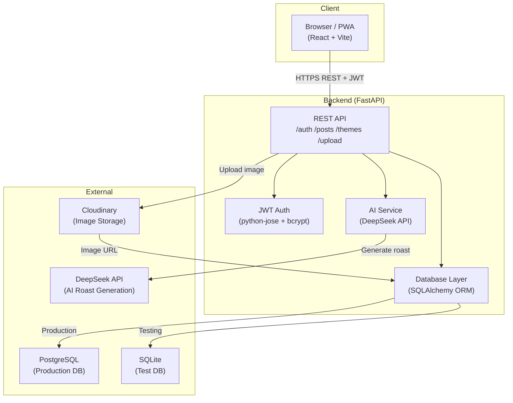
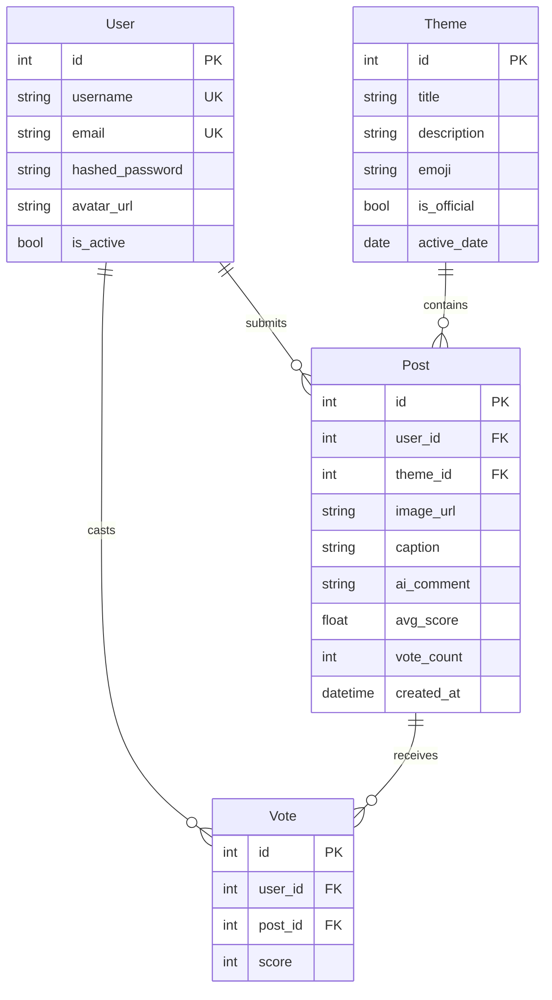
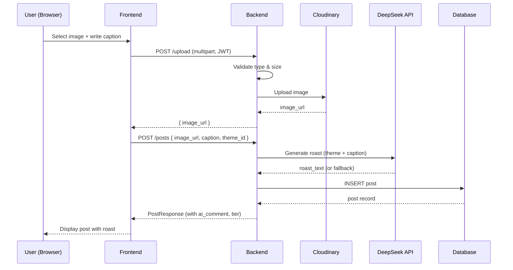

# UniRoast — Architecture Document

## 1. System Architecture Overview



## 2. Component Breakdown

### 2.1 Frontend (React + Vite)
| Component | Responsibility |
|-----------|---------------|
| `App.jsx` | Route definitions, private route wrapper |
| `store/useAuth.js` | Zustand store — JWT token + user state, persisted to localStorage |
| `api.js` | Axios instance — auto-injects `Authorization: Bearer <token>` |
| `pages/` | Route-level components (Home, Login, ThemePage, PostDetail, Leaderboard, Profile) |
| `components/Navbar.jsx` | Navigation header with auth state |

### 2.2 Backend (FastAPI)
| Module | Responsibility |
|--------|---------------|
| `routers/auth.py` | Register, login, get current user |
| `routers/posts.py` | CRUD for posts, voting, tier calculation |
| `routers/themes.py` | Theme management, today's theme filter |
| `routers/upload.py` | Image validation + Cloudinary upload |
| `ai_service.py` | DeepSeek API call, fallback on failure |
| `auth.py` | JWT creation/verification, bcrypt hashing |
| `models.py` | SQLAlchemy ORM models |
| `schemas.py` | Pydantic request/response schemas |
| `database.py` | DB engine, session factory, dependency injection |

### 2.3 Database Schema



## 3. Technology Choices & Rationale

| Technology | Alternative Considered | Reason for Choice |
|------------|----------------------|-------------------|
| **FastAPI** | Flask, Django | Async support, automatic OpenAPI docs, Pydantic validation built-in |
| **React + Vite** | Next.js, Vue | Faster dev server than CRA, team familiarity with React |
| **PostgreSQL** | MySQL, MongoDB | Strong relational integrity for votes/posts; SQLite for tests keeps CI simple |
| **SQLAlchemy + Alembic** | Raw SQL, Tortoise ORM | Industry-standard ORM with migration support |
| **Zustand** | Redux, Context API | Minimal boilerplate for simple auth state |
| **TanStack Query** | SWR, manual fetch | Caching, background refetch, loading/error states out of the box |
| **Cloudinary** | S3, local storage | Free tier sufficient; no infrastructure to manage |
| **DeepSeek API** | OpenAI GPT-4 | Cost-effective; OpenAI-compatible SDK; better Chinese language output |
| **JWT (stateless)** | Session cookies | Stateless auth fits a REST API; easier to scale horizontally |

## 4. Data Flow: Post Submission



## 5. CI/CD Pipeline

```
Push / PR
    │
    ├── Backend job
    │     ├── pip install (cached)
    │     ├── pytest --cov (SQLite test DB)
    │     └── Coverage report (XML + terminal)
    │
    └── Frontend job
          ├── npm ci (cached)
          ├── vitest --coverage
          └── vite build
```

All jobs must pass before a PR can be merged to `develop` or `main`.
