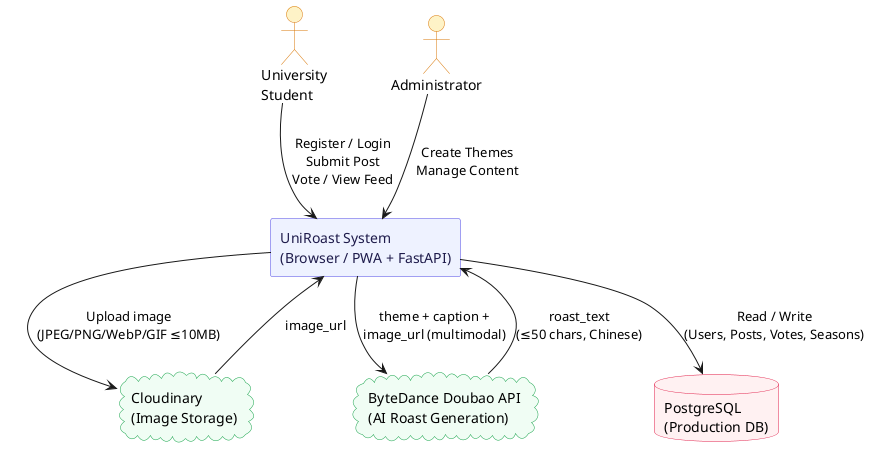
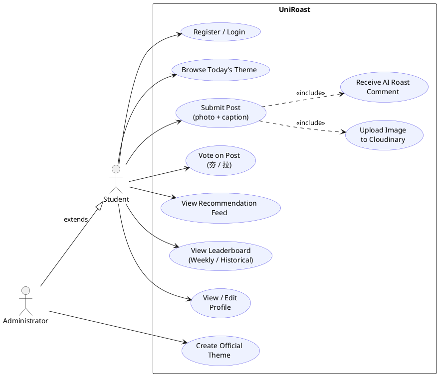
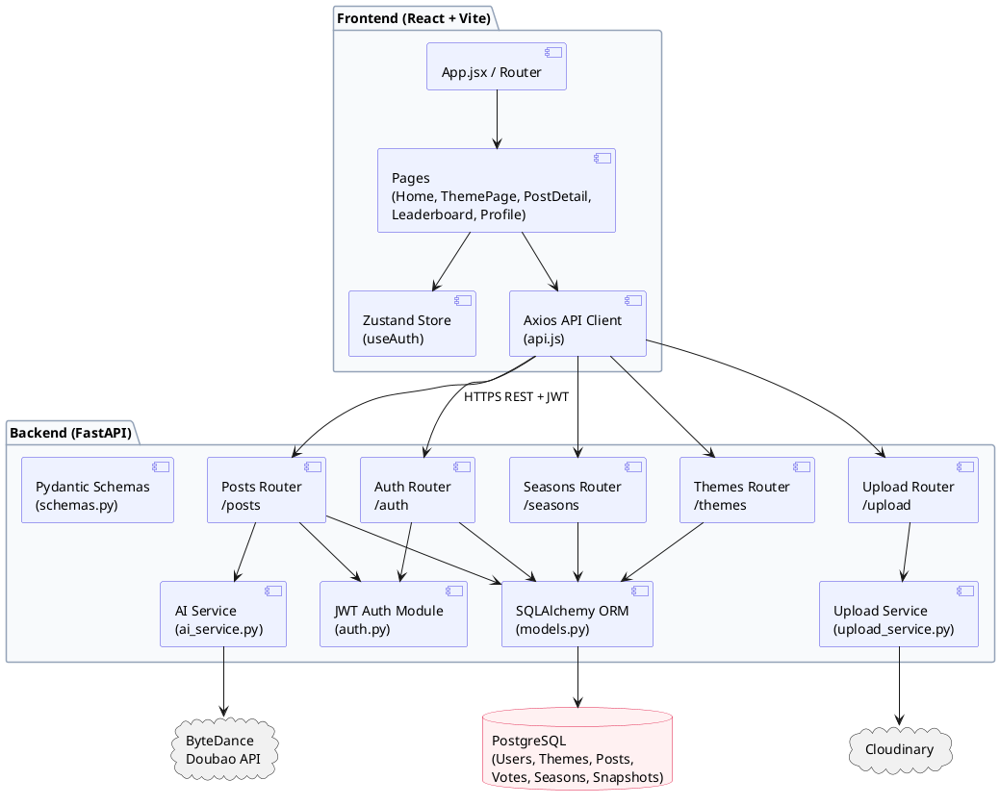
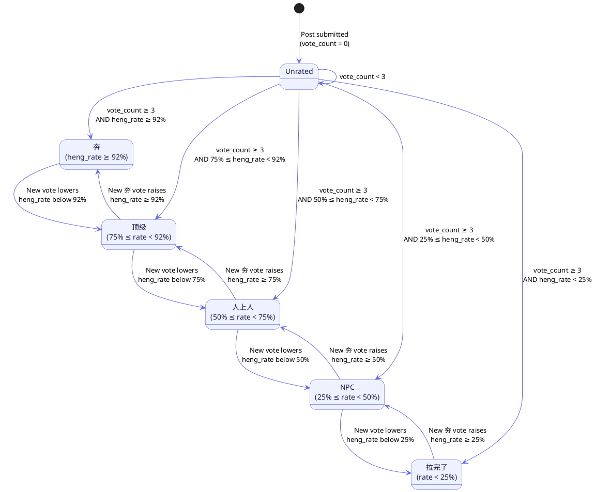

# BSAI301 Project Progress Report
# UniRoast — AI-Powered Campus Social Platform

**Date:** March 21, 2026

**Team ID:** EX1-Team-13

**Team Members:**
- 贺柏诚 (`<Student ID>`)
- 范云杰 (`<Student ID>`)
- 祝天皓 (`<Student ID>`)
- 魏嘉琦 (`<Student ID>`)

**Repository:** https://github.com/BSAI301/course-project-ex1-team-13

---

> **团队注意事项（提交前删除本段）：**
> 1. 替换上方所有 `<Student ID>` 占位符
> 2. 替换所有 `[DIAGRAM: ...]` 占位符（见 Section 2 说明）
> 3. 核对截止日期是否正确（当前填写为 March 21）
> 4. 将 Markdown 转为 LaTeX 或 Word，导出 PDF
> 5. 命名文件为 `EX1-Team-13 Project Progress Report.pdf`

---

## 1  Project Summary and Requirements

### Finalized Project Summary

UniRoast is an AI-assisted campus social platform designed for university students who want to participate in daily themed photo challenges with a competitive and humorous twist. The system allows students to submit photos responding to a daily challenge theme, after which an AI model automatically generates a short, witty roast comment on the submission. Other users can then vote on each post using a binary reaction system ("夯" for approval, "拉" for disapproval), and the platform calculates a heng-rate score that places each post into one of five tier labels: 夯, 顶级, 人上人, NPC, or 拉完了. A weekly seasonal leaderboard records the top-ranked posts at the end of each season, and users build daily streaks by posting consistently. The platform is built on a FastAPI backend with a React + Vite frontend, deployed with PostgreSQL in production and using Cloudinary for image storage and the ByteDance Doubao multimodal API for AI roast generation. UniRoast targets university students seeking a low-stakes, engaging social experience that combines daily creative challenges, AI humor, and gamified peer recognition.

---

### Core Functional Requirements

The following requirements reflect the finalized system as currently implemented. Requirements that differ from the original proposal are annotated with `[UPDATED]` or `[NEW]`; see Section 4 for scope change justification.

**User Authentication**

- **FR-01:** Users can register with a unique username, email, and password.
- **FR-02:** Users can log in and receive a JWT token valid for 7 days. `[UPDATED from 30 min — see §4]`
- **FR-03:** Protected routes require a valid JWT token; unauthenticated requests receive HTTP 401.
- **FR-04:** Passwords are stored as bcrypt hashes and never returned in API responses.

**Daily Challenges (Themes)**

- **FR-05:** Administrators can create themed challenges with a title, description, and emoji.
- **FR-06:** Each theme can be assigned an `active_date` designating it as "today's challenge."
- **FR-07:** Users can view the current day's active theme and browse all past themes.

**Post Submission**

- **FR-08:** Authenticated users can submit a photo and caption for the active theme.
- **FR-09:** Photos are uploaded to Cloudinary; only the resulting URL is stored in the database.
- **FR-10:** Accepted formats: JPEG, PNG, WebP, GIF; maximum file size: 10 MB.
- **FR-11:** Upon submission, the system automatically requests a roast comment from the ByteDance Doubao multimodal vision API, passing the image URL and caption as input. `[UPDATED — originally DeepSeek text-only API]`
- **FR-12:** If the AI service is unavailable, a fallback comment is used and the post is still published (graceful degradation).

**Voting and Ranking**

- **FR-13:** Authenticated users can cast one binary vote per post: "夯" (approval) or "拉" (disapproval). `[UPDATED — originally 1–5 star rating]`
- **FR-14:** The system calculates and stores the running heng-rate (ratio of 夯 votes to total votes) per post. `[UPDATED]`
- **FR-15:** Posts with at least 3 votes are assigned a tier label based on heng-rate: 夯 (≥92%), 顶级 (≥75%), 人上人 (≥50%), NPC (≥25%), 拉完了 (<25%). Posts with fewer than 3 votes are marked "未评级". `[UPDATED]`
- **FR-16:** The leaderboard displays posts in descending order of heng-rate, filtered by current season.
- **FR-17:** A recommendation feed ranks posts using a time-decay scoring formula: score = (heng_count + 0.5 × vote_count) / (age_hours + 2)^1.5. `[NEW]`

**User Profile and Retention**

- **FR-18:** Authenticated users can view and edit their profile (username, bio, private email, phone).
- **FR-19:** The profile page lists all posts submitted by the user with their tier and vote counts.
- **FR-20:** The system tracks each user's consecutive posting streak (`streak` counter and `last_post_date`). `[NEW]`

**Seasonal Leaderboard**

- **FR-21:** The system groups activity into weekly seasons (Monday–Sunday). At the end of each season, the top 50 posts are snapshotted into `SeasonSnapshot` records. `[NEW]`
- **FR-22:** Users can browse historical season leaderboards by season number. `[NEW]`

---

### Core Non-Functional Requirements

- **NFR-01:** API response time for read endpoints (feed, leaderboard) must be < 500 ms under normal load.
- **NFR-02:** Image upload processing (excluding Cloudinary transfer time) must complete within 2 seconds.
- **NFR-03:** Frontend initial load (Largest Contentful Paint) must be < 3 seconds on a standard broadband connection.
- **NFR-04:** All endpoints that modify data require a valid JWT token.
- **NFR-05:** JWT secrets are stored in environment variables and never hardcoded.
- **NFR-06:** File uploads are validated for MIME type and size before being forwarded to Cloudinary.
- **NFR-07:** CORS is restricted to the known frontend origin (`https://uniroast.vercel.app`) in production.
- **NFR-08:** AI roast generation failure must not block post submission (graceful degradation with fallback text).
- **NFR-09:** The CI pipeline must pass on every push; PRs cannot be merged unless CI is green.
- **NFR-10:** The application must be usable on mobile screens ≥ 375 px wide.
- **NFR-11:** The app is installable as a PWA on iOS and Android.
- **NFR-12:** Database schema changes are managed exclusively via Alembic migrations.
- **NFR-13:** Test coverage must be reported in CI for every build.
- **NFR-14:** All environment-specific configuration is managed via `.env` files with a committed `.env.example` template.

---

## 2  System Design Update

> **重要：本 Section 包含 4 个 PlantUML 源码块。团队须用 PlantUML 工具将其渲染为图片，然后替换对应的 `[DIAGRAM: ...]` 占位符。**
>
> **渲染方法（选一）：**
> - VS Code 安装插件 `jebbs.plantuml`，在 `.puml` 文件中按 `Alt+D` 预览，右键导出 PNG
> - 在线渲染：https://www.plantuml.com/plantuml/uml — 粘贴代码即得图片链接
> - IntelliJ IDEA 内置 PlantUML 插件
>
> **注意：不能截图 Mermaid 渲染结果，不能用 AI 生成图片，否则该 Section 得 0 分。**

---

### 2.1 Context Model

The context model shows the system boundary, external actors, and the surrounding environment. UniRoast sits between university students and administrators on one side, and three external services on the other: Cloudinary for image storage, the ByteDance Doubao API for AI roast generation, and a PostgreSQL database for persistence.

**PlantUML 源码（渲染后替换为图片）：**

**[DIAGRAM: 将上方 PlantUML 代码渲染后，将图片插入此处]**

---

### 2.2 Interaction Model

The interaction model uses a use case diagram to show what actors can do within the system. Two primary actors are identified: the Student (regular user) and the Administrator (who can additionally create official themes).

**PlantUML 源码（渲染后替换为图片）：**

**[DIAGRAM: 将上方 PlantUML 代码渲染后，将图片插入此处]**

---

### 2.3 Structural Model

The component diagram illustrates the static organization of the system. The frontend and backend communicate via HTTPS REST; the backend is further decomposed into routers, services, and data access layers.

**PlantUML 源码（渲染后替换为图片）：**

**[DIAGRAM: 将上方 PlantUML 代码渲染后，将图片插入此处]**

---

### 2.4 Behavioral Model

The state machine diagram models the tier lifecycle of a post. A post starts in the "Unrated" state and transitions to one of five tier states once it accumulates at least three votes. Subsequent votes may cause tier transitions as the heng-rate changes.

**PlantUML 源码（渲染后替换为图片）：**

**[DIAGRAM: 将上方 PlantUML 代码渲染后，将图片插入此处]**

---

## 3  Progress Tracking

### 3.1 Planned vs. Completed Work

The table below compares the major work items originally planned in the project proposal against the current development status. All evidence refers to the project GitHub repository: https://github.com/BSAI301/course-project-ex1-team-13

| Originally Planned | Current Status | Evidence |
|-------------------|---------------|---------|
| Repository setup and branch strategy | Done | Commit `69f001a` (2026-01-27 initial commit); branch strategy documented in `workflow.md` (commit `791758b`) |
| Backend: User authentication (JWT, bcrypt) | Done | PR merged via `feature/backend-auth` → PR #2, commit `f6f1491` (2026-03-18) |
| Backend: Post submission CRUD | Done | PR merged via `feature/backend-posts` → PR #3, commit `0336428` (2026-03-18) |
| Backend: AI roast comment integration | Done | PR #5 (`feature/ai-roast-service`, commit `74825ea`, 2026-03-18); later migrated to ByteDance in PR #68 (commit `47affe9`, 2026-03-31) |
| Frontend: Authentication screens | Done | PR #4 (`feature/frontend-auth`, commit `fc6fbc7`, 2026-03-18) |
| Frontend: Feed and post display | Done | PR #1 (`feature/feed-layout-vote-interaction`, commit `68cca24`, 2026-03-18); PR #6 (`feature/frontend-feed-api`, commit `9493fe1`) |
| Image upload to Cloudinary | Done | PR #9 (`feature/backend-image-upload`, commit `33444bf`, 2026-03-26) |
| Theme system (daily challenge) | Done | Commit `eca7cee` — theme model + Alembic migration (2026-03-23) |
| Tier ranking (post classification) | Done | Commit `dc6877e` — tier system redesigned from star rating to heng_rate (2026-03-23) |
| CI pipeline (GitHub Actions) | Done | PR #11 (`feature/test-ci-setup`, commit `4af461a`, 2026-03-26); `.github/workflows/ci.yml` |
| Unit and integration tests | Partial | E2E test added (commit `9a1938b`, 2026-03-28); 16 test cases, coverage 54.8% — integration tests for complete flows still incomplete (issue #24 open) |
| Project management documentation | Done | `Docs/requirements.md`, `Docs/architecture.md` added (commit `38cab65`, 2026-03-28) |
| Leaderboard page | Done | Implemented in `Frontend/src/pages/Leaderboard.jsx`; seasonal leaderboard via PR #76 (commit `058d592`, 2026-03-31) |
| User profile page | Done | PR #84/#85 — Profile, ProfileInfo pages + backend PATCH /auth/me (commits `ff2cb37` ~ `c6c1c54`, 2026-04-05) |

**Progress Justification:** The team delivered all originally planned core features within the first two weeks of development (by 2026-03-18 for backend+frontend core, by 2026-03-26 for CI and image upload). The remaining gap is integration test coverage (issue #24), which is currently treated as a hard requirement and is the highest-priority open item.

---

### 3.2 Current Feature Status

| Feature | Status | Notes |
|---------|--------|-------|
| User registration and login (JWT) | Done | Fully functional; JWT valid 7 days |
| Daily theme challenges | Done | Admin creates themes; `active_date` field for today's theme |
| Photo upload (Cloudinary) | Done | Validates type/size; max 10MB; JPEG/PNG/WebP/GIF |
| AI roast comment generation | Done | ByteDance Doubao multimodal API; fallback on failure |
| Binary voting (夯 / 拉) | Done | Replaced original 1–5 star rating in PR merged 2026-04-04 |
| Tier labeling (5 levels) | Done | Computed from heng_rate, recalculated on each vote |
| Recommendation feed (time-decay) | Done | Algorithm: (heng_count + 0.5×vote_count)/(age_hours+2)^1.5 |
| Weekly seasonal leaderboard | Done | Background scheduler runs Sunday 23:59; top-50 snapshot |
| Historical leaderboard | Done | Accessible via `/seasons/{id}/leaderboard` |
| User profile view and edit | Done | Username, bio, private_email, phone via PATCH /auth/me |
| User streak (连击) | Done | `streak` + `last_post_date` fields; incremented on daily post |
| PWA installable | Done | `vite-plugin-pwa` configured; installable on iOS and Android |
| Comment system | Not started | SQLAlchemy models (`Comment`, `CommentVote`) defined; no router/API yet — deferred to Phase 2 |
| Integration tests (full flow) | In progress | E2E test exists but httpx version conflict causes local failures; CI uses pinned `httpx<0.28` (issue #24) |
| README branch strategy docs | In progress | Issue #25 open |
| Leaderboard UI improvements | In progress | Issue #26 open |

**Feature Justification:** The core value proposition of UniRoast — daily themed photo challenges with AI roasts and gamified tier ranking — is fully implemented. The additions (streaks, seasonal leaderboards, recommendation feed) were made to improve day-to-day engagement and were delivered ahead of schedule.

---

### 3.3 Updated Schedule and Revised Scope

#### Scope Changes

The following changes were made from the original proposal scope. Each change is explained and justified:

| Change | Original | Revised | Reason |
|--------|----------|---------|--------|
| Voting mechanism | 1–5 star numeric rating | Binary 夯/拉 + heng_rate | Simplified UX; reduced decision fatigue; binary reaction better matches the "roast/applaud" tone of the platform |
| AI service provider | DeepSeek API (text-only) | ByteDance Doubao multimodal vision API | DeepSeek's text-only API could not receive images; Doubao supports multimodal input, enabling the "看图锐评" feature where the AI actually sees the submitted photo |
| JWT token lifetime | 30 minutes | 7 days | Mobile-first product — frequent re-login on mobile is disruptive; 7-day expiry is standard for mobile social apps |
| New: Streak system | Not planned | User consecutive posting streak | Identified as a key day-1 retention mechanism; low implementation cost (two DB fields) |
| New: Seasonal leaderboard | Not planned | Weekly season with top-50 snapshot at end | Adds competitive periodic structure; encourages users to post during the season window |
| New: Recommendation feed | Not planned | Time-decay feed algorithm | Simple chronological feed disadvantages late posters; time-decay levels the playing field |
| Deferred: Comment system | Planned in scope | Models defined, API not implemented | Time constraints; decided to prioritize voting and feed experience first; will implement in remaining weeks |

#### Updated Timeline

| Time Period | Milestone | Outcome / Deliverable |
|------------|-----------|----------------------|
| Week 7 (by 2026-04-15) | Integration test coverage | Close issue #24 — backend integration tests for register→login→post→vote→leaderboard full flow, coverage raised above 70% |
| Week 7 (by 2026-04-15) | P0 UI polish | Streak danger banner, emoji voting visual, home page feed refinement |
| Week 8 (by 2026-04-22) | Comment system Phase 2 | Implement `/comments` router, frontend comment thread in PostDetail |
| Week 8 (by 2026-04-22) | README documentation | Close issue #25 — branch strategy section, deployment guide |
| Week 9 (by 2026-04-29) | End-to-end system testing | Full manual and automated flow testing on production (Railway + Vercel) |
| Week 10 (by 2026-05-06) | Demo preparation | Record demo video, prepare slides, feature walkthrough script |
| Week 10–11 | Final Report | Deliverable 4 — complete final report documenting architecture, engineering decisions, and retrospective |

---

## 4  Testing and CI Status

### 4.1 Pipeline / Continuous Integration Status

- **CI Platform:** GitHub Actions (`ubuntu-latest`)
- **Trigger:** Every push and every pull request on all branches
- **Pipeline file:** `.github/workflows/ci.yml`
- **Current Pipeline Status:** Passing on `main` and `develop` branches

The pipeline has two parallel jobs:

**Backend job:**
1. Checkout → Python 3.11 setup (pip cache)
2. Install: `requirements.txt` + `httpx<0.28` + `pytest` + `pytest-cov`
3. Run: `pytest --tb=short -q` with `DATABASE_URL=sqlite:///./test.db` and `SECRET_KEY=test-secret-key`
4. Output: coverage XML + terminal summary

**Frontend job:**
1. Checkout → Node 20 setup (npm cache)
2. Install: `npm ci`
3. Run: `npm run test:coverage`
4. Run: `npm run build` (verifies production build succeeds)

> **Known issue:** Running `pytest` locally without the `httpx<0.28` pin causes `TypeError: Client.__init__() got an unexpected keyword argument`, which results in 16 test collection errors. The CI pipeline avoids this by explicitly pinning the httpx version. This version incompatibility is tracked and will be resolved when we migrate to a pinned `requirements-dev.txt` (part of issue #24).

### 4.2 Test Plan and Testing Progress

- **Test Plan:** The team's strategy is to cover all critical API endpoints with integration-style tests using FastAPI's `TestClient` backed by an in-memory SQLite database (configured in `tests/conftest.py`). Frontend components are tested with Vitest + React Testing Library.

- **Tests Completed:**
  - Root endpoint smoke test
  - Auth: register, login, JWT issuance, duplicate-user rejection, protected endpoint access
  - Themes: list, create, get by ID, 404 handling
  - Posts: create with AI mock (AsyncMock), invalid theme rejection, list posts
  - Votes: binary vote submission, invalid vote type rejection, tier calculation from vote count
  - Schema unit tests: `ratio_to_tier()` function validation for all 5 tier thresholds
  - End-to-end scenario: register → login → create theme → submit post → vote → check leaderboard

- **Current Coverage:** 54.8% line coverage (761 lines, 417 lines covered), reported via `pytest-cov` to `coverage.xml`. Key uncovered areas: `ai_service.py` (tested via mock, not real call), `upload_service.py`, and background scheduler in `main.py`.

- **Next Testing Steps:**
  - Fix httpx version incompatibility to allow local test runs (issue #24)
  - Add integration tests for: profile update flow, seasonal rollover logic, feed pagination
  - Raise overall coverage to ≥70% before final report
  - Add frontend component tests for voting interaction and feed rendering

---

## 5  Risks, Issues, and Next Steps

### 5.1 Risks / Issues Encountered and Actions Taken

**Issue 1: AI API provider could not handle image input (Resolved)**
- *What happened:* The original proposal specified DeepSeek API for AI roast generation. During implementation, the team discovered DeepSeek's API did not support multimodal (image + text) input, which was essential to the "看图锐评" (roast by looking at the photo) feature.
- *Why it mattered:* Without multimodal support, the AI comment would be based only on the text caption, significantly reducing the quality and relevance of roasts.
- *Action taken:* Migrated to ByteDance Doubao vision model API (PR #68, commit `47affe9`, 2026-03-31), which supports image URL as part of the prompt. Required a new API key and endpoint configuration but the SDK interface is OpenAI-compatible, so the code change was minimal.
- *Status:* Resolved.

**Issue 2: Alembic migration double-head conflict (Resolved)**
- *What happened:* Two team members created migration files independently on separate branches. When both were merged to `develop`, Alembic reported a "multiple heads" error and refused to run migrations on the Railway production server.
- *Why it mattered:* Blocked the production deployment; the app failed to start because the database schema was out of sync.
- *Action taken:* Manually edited the newer migration file to set the correct `down_revision` pointing to the older one (commit `877ad82`, 2026-04-04). Added a rule in `workflow.md` to always pull latest `develop` before creating a new migration.
- *Status:* Resolved.

**Issue 3: CORS configuration blocked frontend in production (Resolved)**
- *What happened:* After deploying to Railway (backend) + Vercel (frontend), POST requests from the Vercel domain were blocked by the browser with a CORS error. Investigation showed that FastAPI's CORS middleware had been registered after the routers, making it ineffective.
- *Why it mattered:* All authenticated write operations (post submission, voting) failed on the production deployment.
- *Action taken:* Moved the `CORSMiddleware` registration to before all router includes in `main.py` (PR #63, commit `1280ca0`, 2026-03-31). Also added the Vercel production URL to the allowed origins list.
- *Status:* Resolved.

**Issue 4: Integration test incompatibility with httpx ≥ 0.28 (Ongoing)**
- *What happened:* FastAPI `TestClient` depends on `httpx`. When `httpx` is updated to ≥ 0.28, the `Client.__init__()` signature changed, causing 16 test collection errors. The CI pipeline pins `httpx<0.28`, so CI passes, but local development is broken without the same pin.
- *Why it mattered:* Developers cannot run tests locally without manually adding the pin, which slows down the development feedback cycle.
- *Action taken:* Identified the root cause. Plan is to create a `requirements-dev.txt` with the pinned version and update the team development setup guide (tracked in issue #24).
- *Status:* Ongoing — partially mitigated in CI, fix pending locally.

**Issue 5: JWT expiry caused frequent mobile re-logins (Resolved)**
- *What happened:* The original 30-minute JWT expiry forced mobile users to log in multiple times per session, degrading the user experience significantly during user testing.
- *Action taken:* Extended JWT lifetime to 7 days in `auth.py`. Documented as a scope change in requirements.
- *Status:* Resolved.

---

### 5.2 Next Milestones and Concrete Tasks

| Milestone | Task | Owner | Target |
|-----------|------|-------|--------|
| Integration Tests (Issue #24) | Fix httpx version incompatibility; create `requirements-dev.txt` | 贺柏诚 | 2026-04-12 |
| Integration Tests (Issue #24) | Add integration tests for profile update, seasonal rollover, feed pagination; raise coverage to ≥70% | 范云杰 | 2026-04-15 |
| P0 UI: Streak Banner | Frontend streak danger banner component (fires when streak > 0 and user has not posted today) | 祝天皓 | 2026-04-15 |
| P0 UI: Emoji Voting | Replace "夯/拉" text buttons with emoji reaction components in FeedCard and PostDetail | 魏嘉琦 | 2026-04-15 |
| README (Issue #25) | Add branch strategy diagram and deployment guide to README | 贺柏诚 | 2026-04-18 |
| Leaderboard (Issue #26) | Improve leaderboard UI: seasonal tabs, animated tier badges, skeleton loaders | 范云杰 | 2026-04-22 |
| Comment System (Phase 2) | Implement `/comments` API router (CRUD + nested replies) | 祝天皓 | 2026-04-22 |
| Comment System (Phase 2) | Frontend comment thread component in PostDetail page | 魏嘉琦 | 2026-04-22 |
| Final Demo Prep | End-to-end manual test on Railway + Vercel production; record demo script | All | 2026-04-29 |
| Final Report | Complete Deliverable 4 with architecture decisions and retrospective | All | `<deadline>` |

**Justification:** The priority ordering above reflects the course's emphasis on engineering quality (tests first) before new features. Fixing the integration test gap (issue #24) is a hard requirement per the project's own `workflow.md` and will be the team's first focus this week. P0 UI tasks are low-complexity and high-impact for the upcoming demo.

---

*End of draft. Remember to: fill in student IDs, render and insert UML diagrams, convert to LaTeX/Word, and export as PDF named `EX1-Team-13 Project Progress Report.pdf`.*
